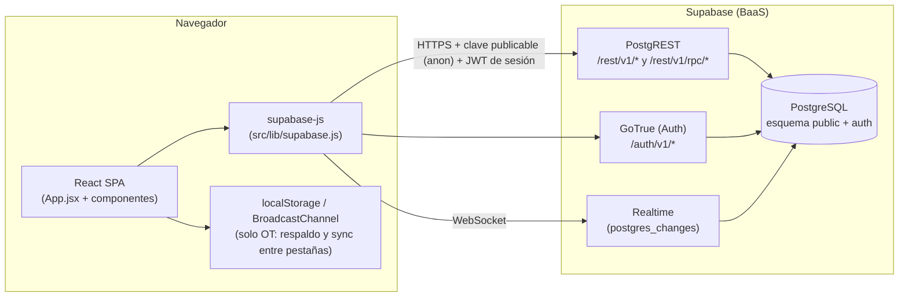
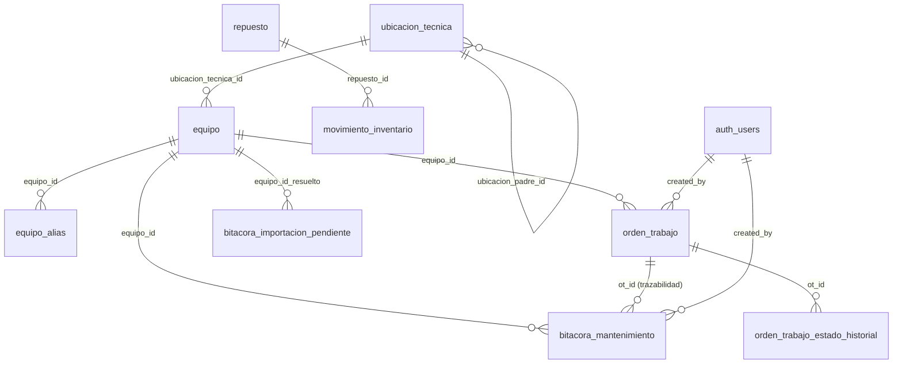
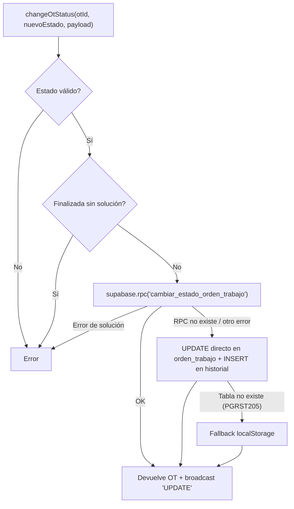

# Sistema de Gestión de Mantenimiento (AGUACOL) — Documentación técnica para despliegue en servidor con PostgreSQL

> **Propósito de este documento:** explicar en detalle cómo funciona el proyecto completo (frontend, base de datos, reglas de negocio, tiempo real, autenticación, importaciones) y qué se necesita para llevarlo a un servidor propio cuya base de datos es **PostgreSQL** (en lugar de Supabase Cloud).
>
> **Cómo se elaboró:** se revisó el código fuente (`src/`), `package.json`, la configuración de Vite y los scripts SQL que están en `scratch/`. Cada afirmación sobre la base de datos está marcada con su nivel de certeza:
>
> | Marca | Significado |
> |---|---|
> | ✅ **Verificado** | Existe un script SQL o código en el repositorio que lo define explícitamente. |
> | 🔎 **Inferido** | Se deduce del uso que hace el código (columnas que lee/escribe). La definición exacta no está en el repositorio. |
> | ⚠️ **Propuesta** | Es una recomendación o reconstrucción mía; debe validarse contra la base real antes de usarla. |

---

## Índice

1. [Resumen ejecutivo](#1-resumen-ejecutivo)
2. [Stack tecnológico](#2-stack-tecnológico)
3. [Estructura del repositorio](#3-estructura-del-repositorio)
4. [Arquitectura actual](#4-arquitectura-actual)
5. [Qué cambia al pasar a un servidor con PostgreSQL (decisión clave)](#5-qué-cambia-al-pasar-a-un-servidor-con-postgresql-decisión-clave)
6. [Modelo de datos](#6-modelo-de-datos)
7. [Autenticación y seguridad](#7-autenticación-y-seguridad)
8. [Módulos funcionales](#8-módulos-funcionales)
9. [Órdenes de Trabajo en profundidad](#9-órdenes-de-trabajo-en-profundidad)
10. [Importación de Excel y resolución de activos](#10-importación-de-excel-y-resolución-de-activos)
11. [Tiempo real](#11-tiempo-real)
12. [Configuración estática dentro del frontend](#12-configuración-estática-dentro-del-frontend)
13. [Variables de entorno y secretos](#13-variables-de-entorno-y-secretos)
14. [Build y despliegue](#14-build-y-despliegue)
15. [Plan de migración paso a paso](#15-plan-de-migración-paso-a-paso)
16. [Mapa de llamadas a datos (para la Opción C: backend propio)](#16-mapa-de-llamadas-a-datos-para-la-opción-c-backend-propio)
17. [Hardening, backups y operación](#17-hardening-backups-y-operación)
18. [Deuda técnica y riesgos conocidos](#18-deuda-técnica-y-riesgos-conocidos)
19. [Checklist final de puesta en producción](#19-checklist-final-de-puesta-en-producción)
20. [Anexos](#20-anexos)

---

## 1. Resumen ejecutivo

El sistema es una **aplicación web de una sola página (SPA)** para gestionar el mantenimiento de la planta **AGUACOL**. Cubre:

- **Órdenes de Trabajo (OT)** con tablero Kanban (Pendiente → En curso → Finalizada), drag & drop, auditoría de estados y tiempo real.
- **Bitácora de Mantenimiento**: historial de intervenciones técnicas, con filtros, alta/edición manual, **importación desde Excel** y validación de registros que no pudieron asociarse a un activo.
- **Árbol de Activos**: jerarquía padre/hijo de equipos (Plásticos, Soplado, Producción/JJV, Servicios Generales, Bodega Tradicional) con ficha técnica, historial de mantenimiento e historial de fallas.
- **Dashboard de Mantenimiento** estilo Fracttal: KPIs, evolución de fallas, intervenciones por tipo/área/técnico, ranking de equipos.
- **Inventario de repuestos**: catálogo, alta de repuestos, retiros de stock y dashboard de inventario (valorizado en CLP).
- **Compras**: solo pantalla placeholder (módulo no implementado).

**Hecho técnico más importante para la migración:** el frontend **no tiene backend propio**. El navegador habla **directamente** con Supabase mediante `@supabase/supabase-js` (PostgREST para datos, GoTrue para login, Realtime para eventos). Por lo tanto, "pasarlo a un servidor con PostgreSQL" no es solo restaurar la base: hay que decidir **qué reemplaza a Supabase** (ver sección 5).

---

## 2. Stack tecnológico

| Capa | Tecnología | Versión (según `package.json`) |
|---|---|---|
| UI | React | ^19.2.8 |
| Bundler / dev server | Vite + `@vitejs/plugin-react` | ^8.2.0 / ^6.0.4 |
| Cliente de datos | `@supabase/supabase-js` | ^2.112.4 |
| Lectura de Excel | `xlsx` (SheetJS) | ^0.18.5 |
| Linter | `oxlint` | ^1.75.0 |
| Automatización de pruebas ad hoc | `puppeteer-core` | ^25.16.0 (solo desarrollo) |
| Lenguaje | JavaScript (JSX), módulos ES (`"type": "module"`) | — |
| Estilos | CSS plano (`src/App.css` ≈ 127 KB, `src/index.css`) | — |
| Enrutamiento | **No hay router.** La navegación es un estado interno `activeView` | — |
| Base de datos actual | PostgreSQL gestionado por Supabase | — |

Scripts disponibles:

```bash
npm run dev       # servidor de desarrollo (Vite)
npm run build     # build de producción -> carpeta dist/
npm run preview   # sirve dist/ localmente
npm run lint      # oxlint (0 errores, 35 warnings informativos al momento de redactar)
```

Resultado de un build reciente: JS ≈ 1.02 MB (≈ 288 KB gzip) y CSS ≈ 93 KB (≈ 15 KB gzip). Vite avisa que un chunk supera 500 KB (ver [deuda técnica](#18-deuda-técnica-y-riesgos-conocidos)).

---

## 3. Estructura del repositorio

```text
Sistema_Mantenimiento/
├─ index.html                      # Punto de entrada HTML (monta #root, carga /src/main.jsx)
├─ vite.config.js                  # Solo plugin de React; sin proxy ni base personalizada
├─ package.json / package-lock.json
├─ .env.local                      # Variables VITE_* (NO subir al repositorio)
├─ gestion de inventario.env       # Copia de variables (NO subir)
├─ public/                         # favicon.svg, icons.svg
├─ src/
│  ├─ main.jsx                     # createRoot + <App/> en StrictMode
│  ├─ App.jsx                      # ≈ 6.400 líneas: estado global, todas las vistas, Bitácora, importador, Árbol de Activos, Inventario
│  ├─ App.css / index.css          # Estilos
│  ├─ lib/
│  │  ├─ supabase.js               # Crea el cliente de Supabase (único punto de conexión)
│  │  └─ tecnicos.js               # parseTecnicos(): separa "Ana / Luis; Pedro" en ['Ana','Luis','Pedro']
│  ├─ config/
│  │  ├─ activosTree.js            # Jerarquía de activos APROBADA (≈ 1.400 líneas, hardcoded) + buildActivosTree()
│  │  ├─ maestroJerarquia.js       # Presets de clasificación progresiva (nombre Excel -> padre/hijo)
│  │  └─ tecnicos.js               # Catálogo oficial de técnicos "BASE V1" (6 técnicos, hardcoded)
│  ├─ services/
│  │  └─ ordenesTrabajoService.js  # Toda la lógica de OT: CRUD, cambio de estado, auditoría, realtime, métricas
│  └─ components/
│     ├─ OrdenesTrabajoView.jsx    # Kanban + ficha de OT + modales (finalizar, reabrir, nueva OT)
│     ├─ DashboardMantenimiento.jsx# Dashboard de mantenimiento con filtros de período
│     └─ ValidacionPendientesView.jsx # Validación de importaciones pendientes (individual y masiva)
├─ scratch/                        # Scripts SQL y utilidades de verificación (ver sección 20)
│  ├─ crear_modulo_ordenes_trabajo.sql        ✅ DDL completo del módulo OT
│  ├─ reconciliacion_maestro_supabase.sql     ✅ Datos maestros de equipos y alias
│  ├─ sync_6_activos_y_transferencia.sql      ✅ Alta de 6 activos + transferencia de pendientes
│  ├─ actualizar_maestro_transpaletas.sql, cerrar_ultimos_3_pendientes.sql, resolver_engrase_grupal_m2_m5.sql
│  └─ *.mjs                                   # Scripts Node de inspección/pruebas (usan credenciales)
├─ Bitácora 23-10-2026.xlsx        # Archivo Excel real de bitácora (datos de la planta)
├─ prueba_controlada_bitacora.xlsx # Excel de prueba
└─ Sistema_Mantenimiento.zip       # Respaldo comprimido del proyecto
```

> **Nota:** no existe ningún archivo `.sql` con el esquema base (tablas `equipo`, `bitacora_mantenimiento`, `repuesto`, vistas, etc.). Solo existen los scripts incrementales de `scratch/`. **El esquema completo debe extraerse de la base actual** (ver sección 15, paso 1).

---

## 4. Arquitectura actual



### Cómo fluye una operación típica

1. El usuario inicia sesión → `supabase.auth.signInWithPassword({ email, password })`. El cliente guarda el JWT (en `localStorage`) y lo adjunta en cada petición.
2. Cada vista consulta tablas/vistas con `supabase.from('tabla').select(...)`. PostgREST traduce esto a SQL y aplica las políticas **RLS** según el rol (`anon` o `authenticated`) que viene en el JWT.
3. Los inserts que dependen del usuario (`created_by`) se rellenan con `DEFAULT auth.uid()` en la base.
4. Para OT, los cambios de estado se hacen con un **RPC** (`cambiar_estado_orden_trabajo`) y se difunden a otras pantallas por **Realtime**.

### Dónde vive la lógica

| Lógica | Ubicación |
|---|---|
| Reglas de transición de OT (obligatoriedad de solución, fechas, auditoría) | **Doble:** BD (trigger + RPC, ✅) y frontend/servicio (validación previa, ✅). |
| Resolución de activos en importación Excel, duplicados, rutinas excluidas | **Solo frontend** (`App.jsx`, función `handleExcelFileSelect`). |
| Validación manual de pendientes | Frontend (`ValidacionPendientesView.jsx`), escribe directo en tablas. |
| Cálculo de métricas del dashboard | Frontend (`DashboardMantenimiento.jsx`, `calculateOtDashboardMetrics`) a partir de listas ya descargadas. |
| Cálculo de stock, valorización, vistas del árbol, ficha del activo | **Vistas SQL** en la base (🔎 definición no incluida en el repo). |

---

## 5. Qué cambia al pasar a un servidor con PostgreSQL (decisión clave)

Una base PostgreSQL "pelada" **no expone una API HTTP**, **no autentica usuarios con email/contraseña**, **no emite JWT** y **no notifica cambios por WebSocket**. Hoy todo eso lo hace Supabase. Hay tres caminos:

| | **Opción A — Supabase self-hosted** | **Opción B — Postgres + PostgREST + Auth externo** | **Opción C — Backend propio (Node/Express/Fastify…)** |
|---|---|---|---|
| Qué se instala | Stack Supabase en Docker (Kong, PostgREST, GoTrue, Realtime, Studio) apuntando a *tu* Postgres | PostgREST + un servicio de login (p.ej. GoTrue, Keycloak, Authentik) + (Realtime opcional) | API REST/WebSocket escrita por ustedes |
| Cambios en el frontend | **Prácticamente ninguno** (solo `VITE_SUPABASE_URL` y claves) | Medios (si no usan GoTrue, hay que reemplazar `supabase.auth`) | **Altos**: reemplazar ~40 llamadas (ver sección 16) |
| Cambios en la base | Mínimos (extensiones/roles de Supabase) | Roles y RLS a medida | Se pueden eliminar RLS/roles `anon`/`authenticated` y manejar permisos en la API |
| Tiempo real | Incluido | Hay que montarlo (LISTEN/NOTIFY + SSE/WS) | Hay que montarlo |
| Mantenimiento | Alto (muchos contenedores) | Medio | Medio/Alto (código propio) |
| Riesgo | Bajo | Medio | Medio (más trabajo, más control) |

### Recomendación

- **Si el requisito es "tener la BD en mi servidor Postgres" y el tiempo es limitado → Opción A.** Es la que menos riesgo introduce: el código actual funciona tal cual.
- **Si el servidor ya tiene un Postgres administrado por TI y no quieren tantos contenedores → Opción C**, siguiendo el mapa de la sección 16. Es la que da más control a largo plazo, pero implica reescribir la capa de datos.
- La Opción B suele terminar pareciéndose a A o a C; solo conviene si ya tienen un proveedor de identidad corporativo.

> **Importante:** el resto del documento sirve para las tres opciones. Donde una instrucción dependa de la opción elegida, se indica explícitamente.

---

## 6. Modelo de datos

### 6.1 Diagrama entidad-relación



### 6.2 Tablas

#### ✅ `orden_trabajo` y `orden_trabajo_estado_historial` (verificadas)

Definidas completamente en [`scratch/crear_modulo_ordenes_trabajo.sql`](scratch/crear_modulo_ordenes_trabajo.sql). Resumen:

| Columna | Tipo | Notas |
|---|---|---|
| `id` | `uuid` PK | `gen_random_uuid()` |
| `numero_ot` | `bigint` identity, UNIQUE | Secuencia `orden_trabajo_numero_ot_seq` |
| `codigo_ot` | `text` generada | `'OT-' || lpad(numero_ot,6,'0')` → `OT-000125` |
| `equipo_id` | `uuid` FK → `equipo(id)` | `ON DELETE SET NULL` |
| `ubicacion`, `area` | `text` | |
| `trabajo` | `text NOT NULL` | Descripción del problema reportado |
| `tecnico` | `text` | Uno o varios, separados por `/` o `;` |
| `estado` | `text NOT NULL` | **Fuente única de verdad**: `Pendiente` \| `En curso` \| `Finalizada` |
| `origen` | `text NOT NULL` | `Manual` \| `Inspección` \| `WhatsApp` |
| `prioridad` | `text NOT NULL` | Default `Media` (el front usa Baja/Media/Alta/Crítica; **no hay CHECK en BD**) |
| `tipo_intervencion` | `text` | Default `Correctiva` |
| `es_falla` | `boolean` | Default `true` |
| `tipo_falla` | `text` | |
| `solucion_definitiva`, `trabajo_pendiente` | `text` | |
| `fecha_reporte` | `timestamptz` | Default `now()` |
| `fecha_inicio`, `fecha_finalizacion` | `timestamptz` | |
| `created_by` | `uuid` | `DEFAULT auth.uid()` |
| `created_at`, `updated_at` | `timestamptz` | |

Restricciones `CHECK`: estado válido, origen válido y **`chk_ot_solucion_requerida_al_finalizar`** (no se puede estar `Finalizada` sin `solucion_definitiva` no vacía).

`orden_trabajo_estado_historial`: `id`, `ot_id` (FK con `ON DELETE CASCADE`), `estado_anterior`, `estado_nuevo`, `fecha_hora`, `usuario_id` (`DEFAULT auth.uid()`), `usuario_nombre`, `comentario`.

Además: trigger `trg_orden_trabajo_before_write` y función RPC `cambiar_estado_orden_trabajo(...)` (detalle en [sección 9](#9-órdenes-de-trabajo-en-profundidad)).

#### 🔎 `equipo` (maestro de activos)

Columnas **confirmadas** por scripts SQL: `id (uuid)`, `codigo`, `nombre`, `area`, `ubicacion_tecnica_id`, `criticidad`, `estado`, `activo (boolean)`, `modelo`.
Columna **usada por el frontend** (OT hace `equipo:equipo_id(id, codigo, nombre, area, ubicacion)`): `ubicacion`. Verifique que exista con `\d public.equipo`.

Convención de códigos: `AGL-<ÁREA>-<GRUPO>-<TIPO>-<NN>`, p. ej. `AGL-PLA-REF-CH-02` (Chiller principal), `AGL-BOD-ELEV-01` (Elevador Bodega Tradicional).

#### 🔎 `ubicacion_tecnica`

`id`, `nombre`, `ubicacion_padre_id` (autorreferencia), `estado`. Los scripts la usan de forma **opcional** (comprueban con `information_schema` si existe). Contiene nodos como AGUACOL, Plásticos, Soplado/PET, Producción/JJV, Galpón Producción, Servicios Generales, Bodega Tradicional.

#### 🔎 `equipo_alias`

`id`, `equipo_id`, `alias`. Mapea nombres históricos que aparecen en el Excel de bitácora al activo oficial (p. ej. "Estanque Acumulador de Agua" → "Estanque de refrigeración de Extrusión"). Se alimenta desde la validación de pendientes (checkbox "guardar alias") y desde scripts de reconciliación. ⚠️ Recomendado: índice único sobre `(lower(alias))` para evitar duplicados.

#### 🔎 `bitacora_mantenimiento`

| Columna | Observación |
|---|---|
| `id` (uuid), `fecha_hora` (timestamptz), `equipo_id` (FK) | |
| `tecnico` (text) | Puede contener varios técnicos |
| `es_falla` (bool), `tipo_falla`, `falla_motivo` | |
| `tipo_intervencion` | **`CHECK chk_tipo_intervencion`**: `Correctiva`, `Preventiva`, `Inspección`, `Ajuste`, `Mejora`, `Otro` |
| `trabajo_realizado` | Obligatorio en el formulario |
| `estado_final` | `Operativo`, `Operativo temporal`, `Pendiente`, `Fuera de servicio` (y `Operativo con seguimiento` desde OT) |
| `area` | |
| `origen` | `Manual`, `Excel`, `Validación de importación`, `Validación de importación masiva`, `OT (OT-xxxxxx)` |
| `import_batch_id` (uuid) | Agrupa las filas de una misma importación |
| `ot_id` (uuid) | Vínculo opcional a la OT que originó la intervención (el front lo lee) |
| `created_by` (uuid) | `DEFAULT auth.uid()` |
| `created_at` | |

#### 🔎 `bitacora_importacion_pendiente`

Cola de filas del Excel que **no se pudieron asociar** a un activo: `id`, `import_batch_id`, `fecha_hora`, `tecnico`, `nombre_equipo_origen`, `area_origen`, `trabajo_realizado`, `es_falla`, `tipo_falla`, `motivo_pendiente`, `estado` (`Pendiente` \| `Resuelto` \| `Ignorado`), `equipo_id_resuelto`, `resolved_at`, `resolved_by`, `motivo_ignorado`, `created_at`. Los registros **nunca se borran**: se conservan para auditoría.

#### 🔎 `repuesto` y `movimiento_inventario`

- `repuesto`: `id`, `codigo` (único), `nombre`, `categoria`, `fabricante`, `numero_parte`, `unidad_medida` (`UND/MTR/LTR/KG/JGO`), `precio_compra`, `moneda_compra` (`CLP/USD/EUR`), `stock_minimo`, `stock_maximo`, `ubicacion_repuesto`, `criticidad` (`Alta/Media/Baja`), `estado` (`Activo/Inactivo/Obsoleto/Descontinuado`).
- `movimiento_inventario`: `id`, `repuesto_id`, `tipo_movimiento` (`Stock Inicial`, `Salida`; probablemente también `Entrada`/`Ajuste`), `cantidad`, `documento_referencia`, `usuario_id`, `observaciones`, `created_at`.

El **stock actual no es una columna de `repuesto`**: lo calcula la vista `vista_inventario` a partir de los movimientos.

#### 🔎 `perfil_usuario`

Mencionada en comentarios del código (`config/tecnicos.js`) como tabla **que no debe modificarse**. El frontend no la consulta directamente.

### 6.3 Vistas (todas 🔎 inferidas, su SQL no está en el repo)

| Vista | Consumida por | Columnas que el front espera |
|---|---|---|
| `vista_inventario` | Lista de repuestos, retiro | Todo `repuesto` + `stock_actual` |
| `vista_dashboard_inventario` | Dashboard de inventario | `valor_total_inventario`, `cantidad_repuestos`, `repuestos_bajo_minimo` |
| `vista_retiros_mensuales` | Gráfico de barras | `mes`, `valor_retiros` |
| `vista_resolucion_equipo` | Importador Excel | `nombre_busqueda`, `nombre_oficial` (o `nombre_maestro`/`nombre`), `codigo`, `equipo_id`, `alias`, `area` |
| `vista_arbol_activos` | Árbol de activos | `node_id, parent_node_id, node_type, equipo_id, nombre, codigo, ruta` |
| `vista_ficha_activo` | Ficha del activo | `equipo_id, total_fallas, fecha_ultima_falla, fallas_ultimos_30_dias` |
| `vista_historial_fallas_activo` | Ficha del activo (pestaña Fallas) | `equipo_id` + datos de bitácora (si falta, el front hace *fallback* directo a `bitacora_mantenimiento` filtrando `es_falla = true`) |

⚠️ **Acción obligatoria:** obtener el SQL real de estas vistas con `pg_dump --schema-only` (sección 15). No las reescriba de memoria: de ellas dependen la resolución automática de activos y los cálculos de stock.

### 6.4 Extensiones y requisitos de PostgreSQL

- Extensión **`pgcrypto`** o PostgreSQL ≥ 13 (para `gen_random_uuid()`; en 13+ viene incluido en el core).
- Zona horaria recomendada para la sesión/servidor: `America/Santiago` (el frontend muestra fechas en `es-CL`; internamente todo es `timestamptz`).
- Codificación **UTF-8** y collation que no rompa tildes/ñ (hay datos como "Leonel Carreño", "Plásticos", "Inspección").

---

## 7. Autenticación y seguridad

### 7.1 Cómo funciona hoy

| Aspecto | Implementación |
|---|---|
| Login | `supabase.auth.signInWithPassword({ email, password })` (vista `login`) |
| Sesión | `supabase.auth.getSession()` al montar y `onAuthStateChange` para reaccionar a login/logout |
| Logout | `supabase.auth.signOut()` |
| Quién necesita sesión | **Bitácora**, **importación**, **validación de pendientes**, **nuevo repuesto**, **retiro**: el front bloquea la vista si `!session` ("Acceso protegido") |
| Quién puede ver sin sesión | Home, Dashboard, OT, Árbol de Activos, Inventario (lectura) — **a nivel de UI**; lo que realmente se permite lo define RLS |
| Creación de usuarios | **No hay pantalla de registro.** Los usuarios se crean en Supabase Auth (panel). No existe gestión de roles en la UI |
| Técnicos | Catálogo **hardcoded** en `src/config/tecnicos.js` (no son usuarios del sistema; son nombres para asignar trabajos) |

### 7.2 Políticas RLS conocidas (✅ de `crear_modulo_ordenes_trabajo.sql`)

```sql
-- orden_trabajo y orden_trabajo_estado_historial:
CREATE POLICY ... FOR SELECT TO authenticated, anon USING (true);
CREATE POLICY ... FOR INSERT TO authenticated, anon WITH CHECK (true);
CREATE POLICY ... FOR UPDATE TO authenticated, anon USING (true) WITH CHECK (true);
GRANT SELECT, INSERT, UPDATE, DELETE ON ... TO authenticated, anon;
```

> ⚠️ **Hallazgo de seguridad:** hoy **cualquier visitante anónimo (sin login) que conozca la URL y la clave publicable puede leer, crear, modificar e incluso BORRAR órdenes de trabajo** (`GRANT ... DELETE ... TO anon`). Para producción en un servidor propio se recomienda restringir a `authenticated` y quitar `DELETE`. Las políticas de las demás tablas **no están en el repo**; revíselas con:
>
> ```sql
> SELECT schemaname, tablename, policyname, roles, cmd, qual, with_check
> FROM pg_policies WHERE schemaname = 'public' ORDER BY tablename;
> ```

### 7.3 Qué reemplaza a `auth.uid()` fuera de Supabase

En PostgreSQL estándar **no existe el esquema `auth` ni las funciones `auth.uid()` / roles `anon`/`authenticated`**. Si usa la Opción C (o B sin GoTrue):

- Reemplace `DEFAULT auth.uid()` por un valor que **la API inyecte por sesión**:
  ```sql
  -- La API ejecuta al inicio de cada transacción:
  SELECT set_config('app.user_id', '<uuid-del-usuario>', true);
  -- Y en la tabla:
  created_by uuid DEFAULT NULLIF(current_setting('app.user_id', true), '')::uuid
  ```
- Cree una tabla propia `usuario` (id uuid, email, password_hash, rol, activo) o integre su proveedor de identidad, y haga que `created_by`/`usuario_id`/`resolved_by` apunten a ella (o déjelos sin FK, como ahora, ya que apuntan a `auth.users` de Supabase).
- Las funciones `SECURITY DEFINER` y `GRANT ... TO authenticated, anon` del script de OT deben adaptarse a los roles que use su servidor.

---

## 8. Módulos funcionales

La navegación es una barra lateral (`<aside className="sidebar">`) que cambia el estado `activeView`. **No hay URLs por vista** (no se puede enlazar a una pantalla concreta), lo que simplifica el servidor web: solo se sirve `index.html`.

| `activeView` | Pantalla | Datos que consulta | Escritura |
|---|---|---|---|
| `home` | Inicio con tarjetas de acceso a módulos | OT (para resumen) | — |
| `dashboard` | Dashboard de Mantenimiento (estilo Fracttal) | `bitacora_mantenimiento`, `equipo`, `orden_trabajo` | — |
| `ordenes-trabajo` | Kanban de OT | `orden_trabajo`, historial | Sí (ver sección 9) |
| `bitacora` | Bitácora: Registradas / Validar importaciones | `bitacora_mantenimiento`, `bitacora_importacion_pendiente`, `vista_resolucion_equipo`, `vista_arbol_activos` | Sí |
| `arbol-activos` | Árbol jerárquico + ficha del activo | `equipo`, `vista_arbol_activos`, `vista_ficha_activo`, `vista_historial_fallas_activo`, `bitacora_mantenimiento` | No (botones "Nuevo activo"/"Editar activo" deshabilitados: "Próximamente") |
| `dashboard-inventario` | KPIs de inventario y gráfico de retiros | `vista_dashboard_inventario`, `vista_retiros_mensuales` | — |
| `repuestos` | Catálogo de repuestos | `vista_inventario` | — |
| `nuevo-repuesto` | Alta de repuesto (requiere sesión) | — | `repuesto`, `movimiento_inventario` |
| `retiro` | Retiro de repuestos con autocompletado (requiere sesión) | `vista_inventario` | `movimiento_inventario` |
| `compras` | Placeholder "Módulo en desarrollo" | — | — |
| `login` | Inicio de sesión | — | Auth |

### 8.1 Dashboard de Mantenimiento

Componente [`DashboardMantenimiento.jsx`](src/components/DashboardMantenimiento.jsx). Todo se calcula **en el navegador** sobre `bitacoraList` y `ordenesTrabajoList`.

- **Filtros de período:** toda la bitácora, hoy, día específico, mes específico, año específico, últimos 30 días / 3 / 6 / 12 meses, personalizado (desde–hasta). Además filtros estructurales (área, equipo, técnico, tipo de intervención, tipo de falla).
- **Bloque OT:** *OT Pendientes*, *OT En curso* (estado actual, independientes del período) y *OT Cerradas del período* (usa `fecha_finalizacion` dentro del rango).
- **Gráficos/tablas:** evolución de fallas (últimos 12 meses), intervenciones por tipo, fallas por área, tipos de falla, intervenciones por técnico (un registro con "Ana / Luis" cuenta para ambos, vía `parseTecnicos`), Top 10 equipos con más fallas, equipos más críticos.
- Los gráficos pueden navegar a la Bitácora o a la ficha del activo con filtros precargados.

> Consecuencia para el servidor: el dashboard **descarga toda la bitácora** y calcula en cliente. Con crecimiento fuerte de datos conviene paginar o crear vistas agregadas (ver deuda técnica).

### 8.2 Bitácora de Mantenimiento

- **Cabecera:** título + botones `📊 Importar Excel` y `+ Nueva intervención` (solo con sesión).
- **Sub-pestañas:** `Intervenciones Registradas` y `Validar importaciones` (con contador de pendientes).
- **Filtros:** búsqueda libre (técnico/equipo/motivo/trabajo), equipo, área, tipo de intervención, tipo de falla, ¿es falla?, fecha desde/hasta.
- **Tabla:** fecha/hora, técnico, equipo, área, tipo, ¿falla?, falla/motivo, trabajo realizado, estado final, tipo de falla, botón **Editar**.
- **Formulario de intervención (modal):** fecha y hora, equipo (del maestro; solo activos), técnico (catálogo oficial o "Otro / pendiente de registrar" con texto libre), área, tipo de intervención, estado final, casilla *¿Es falla?* (si está activa, **tipo de falla es obligatorio**), falla/motivo y trabajo realizado (obligatorio). Inserta con `origen: 'Manual'`; `created_by` lo completa la BD.
- **Validación en BD:** el `CHECK chk_tipo_intervencion` obliga a uno de los 6 valores permitidos; el importador lo verifica antes de enviar.

### 8.3 Árbol de Activos

- El árbol visible se construye con `buildActivosTree(equiposList, supabaseArbolNodes)` (en `config/activosTree.js`): parte de la **jerarquía aprobada hardcoded** (`JERARQUIA_APROBADA`) y la enriquece/cruza con los equipos reales de la BD y los nodos de `vista_arbol_activos`.
- Panel izquierdo: búsqueda, expandir/contraer, áreas → equipos padre → hijos, indicador de estado (Operativo / En mantenimiento / Fuera de servicio / Inactivo).
- Panel derecho (ficha), con 5 pestañas: **Información General** (código, nombre, área, estado, criticidad, tipo padre/hijo, fabricante, modelo, serie, ubicación, formatos/moldes compatibles en inyectoras y extrusoras), **Historial de Mantenimiento** (hasta 100 últimas intervenciones de `bitacora_mantenimiento`), **Historial de Fallas** (métricas + tabla), **Repuestos Asociados** (placeholder) y **Documentación** (placeholder con archivos de ejemplo, no reales).
- Botón *Ver Bitácora* salta a la Bitácora filtrada por ese activo.

### 8.4 Inventario de repuestos

- **Alta de repuesto:** valida código, nombre, categoría, unidad, stock mínimo, criticidad y estado; si hay precio exige moneda; stock máximo ≥ mínimo. Inserta en `repuesto` y, si hay *stock inicial* > 0, registra un movimiento `Stock Inicial` en `movimiento_inventario`.
- **Retiro:** autocompletado (código/nombre/fabricante/nº de parte, sin tildes ni mayúsculas, máx. 10 resultados). Valida cantidad > 0 y ≤ stock disponible. Inserta movimiento `Salida` y recarga `vista_inventario`.
- **Dashboard de inventario:** KPIs (valor total, cantidad de repuestos, repuestos bajo mínimo) y gráfico de barras de retiros mensuales valorizados.
- ⚠️ La verificación de stock suficiente se hace **en el cliente**. Verifique si existe un trigger en BD que impida stock negativo; si no, agréguelo (concurrencia: dos retiros simultáneos podrían dejar stock negativo).

---

## 9. Órdenes de Trabajo en profundidad

### 9.1 Principio de diseño

Una **sola fuente de verdad**: `orden_trabajo.estado ∈ {Pendiente, En curso, Finalizada}`. No existe un estado separado para el Kanban ni una posición de tarjeta guardada: el Kanban, la ficha individual y el dashboard leen/modifican exactamente ese campo.

### 9.2 Máquina de estados

```mermaid
stateDiagram-v2
    [*] --> Pendiente: Crear OT (Manual / Inspección / WhatsApp)
    Pendiente --> EnCurso: Iniciar (asigna fecha_inicio si es NULL)
    EnCurso --> Finalizada: Finalizar (exige solución definitiva)
    Finalizada --> EnCurso: Reabrir (confirmación; fecha_finalizacion = NULL)
    EnCurso --> Pendiente: Devolver (confirmación; conserva fecha_inicio)
    state "En curso" as EnCurso
```



| Transición | Efecto en datos | Confirmación UI |
|---|---|---|
| Crear (Inspección o WhatsApp) | Entra **siempre** como `Pendiente` | — |
| Pendiente → En curso | `estado='En curso'`; `fecha_inicio = COALESCE(fecha_inicio, now())`; `fecha_finalizacion = NULL` | Toast "OT-000125 iniciada" |
| En curso → Finalizada | Requiere `solucion_definitiva` no vacía; `fecha_finalizacion = now()`; guarda `trabajo_pendiente` y `tecnico` si se editan | **Modal de cierre**: OT, equipo, trabajo, solución (obligatoria), trabajo pendiente (opcional), técnico(s) |
| Finalizada → En curso | `fecha_finalizacion = NULL`; **no** borra solución ni trabajo pendiente | "¿Desea reabrir la OT-000125?" |
| En curso → Pendiente | `estado='Pendiente'`; **conserva** `fecha_inicio` | Confirmación |

Cada cambio de estado inserta una fila en `orden_trabajo_estado_historial` (estado anterior/nuevo, fecha, usuario, comentario).

### 9.3 Defensa en profundidad de la regla "no finalizar sin solución"

La regla se aplica en **tres niveles**:

1. **UI/servicio** (`changeOtStatus` en `ordenesTrabajoService.js`): lanza error si `solucion_definitiva` está vacía.
2. **RPC** `cambiar_estado_orden_trabajo`: `RAISE EXCEPTION 'No es posible finalizar la OT sin registrar una solución definitiva.'`.
3. **BD**: `CHECK chk_ot_solucion_requerida_al_finalizar` + trigger `BEFORE INSERT OR UPDATE`. Aunque alguien actualice la tabla "a mano", no podrá finalizar sin solución.

### 9.4 Trigger y RPC (✅ en `crear_modulo_ordenes_trabajo.sql`)

- **`trg_fn_orden_trabajo_before_write`**: actualiza `updated_at`; asigna `fecha_inicio` al pasar a `En curso`; rechaza `Finalizada` sin solución y pone `fecha_finalizacion`; al salir de `Finalizada` la limpia; evita perder `fecha_inicio`.
- **`cambiar_estado_orden_trabajo(p_ot_id, p_nuevo_estado, p_solucion_definitiva, p_trabajo_pendiente, p_tecnico, p_comentario, p_usuario_nombre)`**: función `SECURITY DEFINER` que bloquea la fila (`FOR UPDATE`), aplica las reglas, actualiza y escribe la auditoría en una sola transacción; devuelve la fila completa.

### 9.5 Flujo en el servicio (`changeOtStatus`)



> ⚠️ **Importante para producción:** existe un **modo de respaldo en `localStorage`** (claves `aguacol_orden_trabajo_db_v1` y `aguacol_orden_trabajo_historial_db_v1`) que se activa **silenciosamente** si la tabla `orden_trabajo` no existe o el servidor no responde (`PGRST205`, `fetch failed`, `placeholder.supabase.co`). Incluso **siembra 4 OT de ejemplo** (OT-000118, 120, 125, 126). En producción esto es peligroso: el usuario podría creer que está guardando en el servidor cuando solo guarda en su navegador. Opciones: (a) asegurar que las tablas existan siempre y monitorear `otStorageMode` (`supabase_live` vs `supabase_pending_migration`), o (b) eliminar el fallback del código (recomendado).

### 9.6 Interfaz Kanban (`OrdenesTrabajoView.jsx`)

- **Cabecera:** "Órdenes de Trabajo" + "Gestión y seguimiento de trabajos de mantenimiento"; botones `Ver Dashboard` y `+ Nueva OT`.
- **4 KPIs:** Pendientes, En curso, Finalizadas, Cerradas del período.
- **Filtros en una barra:** búsqueda, equipo, técnico, origen, limpiar.
- **3 columnas** (Pendientes / En curso / Finalizadas) con contador; en móvil se apilan/pestañas.
- **Drag & drop** nativo HTML5 (`dataTransfer`), con *optimistic UI*: la tarjeta se mueve al instante y **se revierte** si el servidor rechaza ("No fue posible actualizar la OT.").
- **Estados de carga separados:** `initialLoading` (solo primera carga), `backgroundRefreshing` (silencioso) y `updatingOtId` (solo la tarjeta afectada). El encabezado no muestra spinners.
- **Ficha de OT:** edición de técnico, prioridad, solución, trabajo pendiente, ubicación, etc., e historial de estados.

### 9.7 Métricas de OT (`calculateOtDashboardMetrics`)

- *Pendientes actuales / En curso actuales*: conteo por `estado`, **independiente del filtro de fechas**, respetando filtros de área/equipo/técnico.
- *Finalizadas del período*: usa **`fecha_finalizacion`** dentro del rango.
- *Reportadas del período*: usa `fecha_reporte`.

### 9.8 Vínculo con la Bitácora

`prepareBitacoraPayloadFromOt(ot)` arma el registro de bitácora (con `ot_id`, `origen: 'OT (OT-xxxxxx)'`) para una OT finalizada, pero **no inserta automáticamente** para no duplicar sin confirmación. La columna `bitacora_mantenimiento.ot_id` existe (el front la lee en la ficha del activo).

---

## 10. Importación de Excel y resolución de activos

Es la parte más compleja del frontend (`handleExcelFileSelect`, `handleExecuteImport` en `App.jsx`). **Toda la inteligencia vive en el navegador**; la base solo recibe el resultado.

### 10.1 Lectura del archivo

- Biblioteca `xlsx`. Busca la hoja **"Síntesis"** (o la hoja principal) y opcionalmente una hoja **"Historial fallas"** (cuyos registros marcan `es_falla = true` y aportan tipo de falla, motivo y estado final).
- Detecta dinámicamente la fila de encabezados (los archivos reales pueden traer un dashboard previo).
- Columnas esperadas: **Fecha, Técnico, Máquina, Área, Comentario**.
- Fechas: parser robusto (serial de Excel, `YYYY-MM-DD`, `DD/MM/YYYY`, etc.) sin desfase de zona horaria.

### 10.2 Clasificación de cada fila (5 estados oficiales)

| Estado de fila | Condición | Destino |
|---|---|---|
| **Resuelto** | Fecha válida + técnico presente + activo identificado | `bitacora_mantenimiento` (`origen='Excel'`) |
| **Pendiente** | Activo no resuelto o término ambiguo | `bitacora_importacion_pendiente` |
| **Duplicado** | Misma (fecha-día, equipo, técnico, trabajo) ya en BD o repetido en el mismo archivo | Se omite |
| **Rutina preventiva / excluida** | Despiche rutinario de acumuladores sin anomalía | Se omite |
| **Error** | Fecha inválida o técnico vacío | Se informa; no se inserta |

### 10.3 Orden de resolución del activo (sin *fuzzy matching*)

1. **`vista_resolucion_equipo`**: coincidencia exacta normalizada (trim, espacios únicos, minúsculas) del nombre contra `nombre_busqueda`, alias, nombre oficial o código.
2. **Coincidencia exacta directa** contra `equipo` o contra el árbol aprobado (con tabla de alias de respaldo `BASE_ALIAS_FALLBACK`, p. ej. "inyectora de tapas" → "Inyectora 2"; "Línea 3" → "JJV Línea 3").
3. **Presets aprobados** (`maestroJerarquia.js`).
4. **Reglas de contexto validadas por el usuario** (por ejemplo: "Refrigeración" + "chiller principal" → *Chiller principal*; "Producción" + "bomba sumergible" → *Bomba sumergible Galpón de Producción*; "Cocina" + "iluminación" → *Sistema de iluminación Cocina*; "Instalaciones" + "portón" → *Portón de acceso a planta*; "PET/Soplado" + "IBC" → *Chiller Soplado*; etc.).
5. Si nada aplica → **Pendiente**.

**Términos ambiguos** (`refrigeración`, `extrusión`, `producción`, `cocina`, `instalaciones`, `PET`, `plásticos`, `soplado`, `servicios generales`) **jamás** se convierten automáticamente en un equipo salvo alias explícito o regla de contexto.

**Expansión grupal preventiva:** un comentario como "rellena grasa en M2, M3, M4 y M5" genera **una fila por máquina** (tipo `Preventiva`, no falla).

### 10.4 Reglas de tipo de intervención

`normalizarTipoIntervencion` garantiza que solo salgan los 6 valores del `CHECK` (`Correctiva`, `Preventiva`, `Inspección`, `Ajuste`, `Mejora`, `Otro`). Si es falla → `Correctiva`; si no, se clasifica por palabras clave del trabajo (engrase/lubricación → Preventiva; calibración/ajuste → Ajuste; inspección/revisión → Inspección…). **Antes de enviar**, el lote se valida completo y, si hay un tipo inválido, **no se envía nada**.

### 10.5 Clasificación progresiva del maestro de equipos

Modal con dos pestañas: **Clasificación Progresiva de Equipos** (agrupa los nombres únicos del Excel y permite marcar *asignar a equipo existente / nuevo padre / nuevo hijo de padre existente*) y **Vista Previa de Filas**. Regla de negocio explícita: *"No se crean ni relacionan equipos automáticamente… todo nombre nuevo requiere confirmación manual del administrador"*. Estas decisiones son **solo de preparación visual** hoy: no escriben en BD.

### 10.6 Validación de pendientes (`ValidacionPendientesView.jsx`)

- **Individual:** elegir activo oficial → inserta en `bitacora_mantenimiento` (`origen='Validación de importación'`), marca el pendiente `Resuelto` (con `equipo_id_resuelto`, `resolved_at`, `resolved_by`) y, opcionalmente, guarda **alias** en `equipo_alias`. Rechaza alias genéricos (`TERMINOS_GENERICOS_PROHIBIDOS`: producción, extrusión, PET, cocina, soplado, planta, galpón…).
- **Masiva:** selecciona varios pendientes → un solo activo → inserción por lote + `UPDATE ... WHERE id IN (...)`.
- **Ignorar:** marca `Ignorado` con motivo (p. ej. "Rutina operativa"); no entra a la bitácora.
- Sugerencias automáticas de candidatos (transpaletas, M1–M5, S1/S2, chillers, inyectoras, cocina).

> ⚠️ **No hay transacción:** el insert en bitácora y el update del pendiente son dos llamadas separadas; si falla la segunda, el registro queda duplicado (en bitácora y aún pendiente). Se recomienda moverlo a una función SQL/endpoint transaccional.

---

## 11. Tiempo real

### 11.1 Qué usa hoy

| Mecanismo | Alcance | Detalle |
|---|---|---|
| **Supabase Realtime** (`postgres_changes`) | Cambios de otros usuarios/equipos | Canal sobre `public.orden_trabajo` (INSERT/UPDATE/DELETE) y `orden_trabajo_estado_historial` (INSERT). Requiere que ambas tablas estén en la publicación `supabase_realtime` (el script de OT lo hace) |
| **`BroadcastChannel`** `aguacol_orden_trabajo_realtime_v1` | Entre pestañas del **mismo** navegador | Se emite tras cada cambio local |
| **Evento `storage`** | Solo modo respaldo localStorage | |

La app **no usa polling** (`setInterval`). La suscripción se crea **una vez** al montar `App`, aplica el payload directamente al estado y dispara una re-sincronización silenciosa (`fetchOrdenesTrabajoList({ silent: true })`).

### 11.2 Alternativas fuera de Supabase

- **Opción A:** Realtime de Supabase self-hosted (necesita `wal_level=logical` en Postgres y la publicación).
- **Opción C:** reemplazar por **LISTEN/NOTIFY**:
  ```sql
  CREATE OR REPLACE FUNCTION notify_orden_trabajo() RETURNS trigger LANGUAGE plpgsql AS $$
  BEGIN
    PERFORM pg_notify('orden_trabajo_changes',
      json_build_object('op', TG_OP,
                        'new', CASE WHEN TG_OP <> 'DELETE' THEN row_to_json(NEW) END,
                        'old', CASE WHEN TG_OP = 'DELETE'  THEN row_to_json(OLD) END)::text);
    RETURN COALESCE(NEW, OLD);
  END $$;

  CREATE TRIGGER trg_ot_notify AFTER INSERT OR UPDATE OR DELETE ON public.orden_trabajo
  FOR EACH ROW EXECUTE FUNCTION notify_orden_trabajo();
  ```
  La API escucha `LISTEN orden_trabajo_changes` y retransmite por **Server-Sent Events** o **WebSocket**. En el frontend solo habría que reescribir `subscribeToOrdenesTrabajoRealtime` (conservando la misma forma `{ eventType, newRecord, oldRecord }`). Atención: `pg_notify` limita el payload a ~8 000 bytes; si una OT es muy grande, envíe solo `id` y que el cliente haga *fetch*.

---

## 12. Configuración estática dentro del frontend

Estos datos **no están en la base**; cambiarlos exige **recompilar y redesplegar**:

| Archivo | Contenido | Impacto |
|---|---|---|
| `src/config/tecnicos.js` | 6 técnicos: Leonel Carreño, Maximiliano Badilla, Elias Gonzalez, Victor Muñoz, Mauricio Riquelme, Willi Orellana | Altas/bajas de técnicos requieren nuevo build |
| `src/config/activosTree.js` | Jerarquía completa de activos (Plásticos → Inyección/Extrusión/Refrigeración/Logística; Soplado; Producción/JJV; Servicios Generales; Bodega Tradicional), formatos y moldes compatibles, estados y colores | El árbol *visible* se basa en esto, cruzado con `equipo`/`vista_arbol_activos` |
| `src/config/maestroJerarquia.js` | Presets de clasificación aprobada (Moledora M3 → hijo de M3; Elevador Bodega; Chillers; "Inyectora de tapas" → Inyectora 2…) | Se usan en la resolución de activos al importar |
| `ordenesTrabajoService.js` | Orígenes (`Manual/Inspección/WhatsApp`), prioridades (`Baja/Media/Alta/Crítica`), estados | Deben coincidir con los `CHECK` de la BD |
| `App.jsx` | `TERMINOS_AMBIGUOS`, tabla `BASE_ALIAS_FALLBACK`, reglas de contexto de importación | Lógica de negocio embebida |

> ⚠️ **Riesgo de desincronización:** el árbol hardcoded y la tabla `equipo` pueden divergir (nombres/códigos). Si se renombra un activo en la BD sin actualizar `activosTree.js`, el árbol o el importador podrían no cruzarlos. A mediano plazo se recomienda mover técnicos y jerarquía a tablas de BD.

---

## 13. Variables de entorno y secretos

### 13.1 Variables que lee el frontend (`src/lib/supabase.js`)

| Variable | Uso |
|---|---|
| `VITE_SUPABASE_URL` | URL base del backend (Supabase Cloud, Supabase self-hosted o su API) |
| `VITE_SUPABASE_PUBLISHABLE_KEY` | Clave pública (anon/publishable) |

Si faltan, el código usa **valores placeholder** (`https://placeholder.supabase.co`, `placeholder-key`) y la app arranca pero todas las llamadas fallan (y OT cae al modo `localStorage`).

> ⚠️ Las variables `VITE_*` se **incrustan en el JavaScript durante `npm run build`**. Cambiar de servidor implica **volver a compilar** (no basta con editar un `.env` en el servidor). Para una imagen Docker única para varios entornos habría que inyectar la configuración en runtime (p. ej. un `config.js` servido aparte).

### 13.2 Archivos sensibles presentes en el proyecto

| Archivo | Riesgo | Acción |
|---|---|---|
| `.env.local`, `gestion de inventario.env` | Contienen URL y clave del proyecto Supabase actual | No subir al repo (están en `.gitignore` por `*.local` / `*.env`); crear nuevos para el servidor |
| `scratch/*.mjs` (varios) | **Tienen URL y clave publicable escritas en el código** (p. ej. `check_equipo_cols.mjs`) | **Eliminar `scratch/` del paquete de despliegue**; rotar la clave si el repositorio fue compartido |
| `scratch/auth_session.json`, `scratch/live_access_token.txt` | **Tokens de sesión reales** (JWT) | **Borrar y no distribuir**; invalidar sesiones del usuario asociado |
| `scratch/*.sql` | Contienen UUID reales y un `created_by` fijo (`796275b6-…`) | Revisar antes de reutilizar en otro entorno |
| `Sistema_Mantenimiento.zip`, `*.xlsx` | Copia del código y datos reales de la planta | No publicar en el servidor web |

---

## 14. Build y despliegue

### 14.1 Requisitos del servidor (frontend)

- **Node.js** solo para compilar (verifique la versión mínima que exige Vite 8 en su documentación; use una LTS reciente, p. ej. 22). En el servidor final **no hace falta Node** si compila en CI/máquina de build y sube `dist/`.
- Un servidor web estático (Nginx, Caddy, Apache) con **HTTPS**. HTTPS es relevante porque APIs como `crypto.randomUUID()` solo existen en contextos seguros (el código tiene *fallback*, pero conviene HTTPS igualmente para el login).

### 14.2 Compilar

```bash
npm ci
# Defina las variables ANTES del build (apuntando a SU backend):
#   VITE_SUPABASE_URL=https://api.mi-servidor.cl
#   VITE_SUPABASE_PUBLISHABLE_KEY=<clave>
npm run build        # genera dist/
```

### 14.3 Nginx (SPA)

Como no hay router por URL, basta con servir archivos estáticos; el *fallback* a `index.html` es una buena práctica por si se agrega router a futuro.

```nginx
server {
  listen 443 ssl http2;
  server_name mantenimiento.midominio.cl;

  root /var/www/sistema-mantenimiento/dist;
  index index.html;

  # Assets con hash: caché larga
  location /assets/ {
    add_header Cache-Control "public, max-age=31536000, immutable";
    try_files $uri =404;
  }

  # index.html: nunca cachear (para que tome el build nuevo)
  location = /index.html {
    add_header Cache-Control "no-store";
  }

  location / {
    try_files $uri /index.html;
  }

  gzip on;
  gzip_types text/css application/javascript image/svg+xml application/json;
}
```

### 14.4 Docker (build multi-etapa) — ⚠️ propuesta

```dockerfile
# ---- build ----
FROM node:22-alpine AS build
WORKDIR /app
COPY package*.json ./
RUN npm ci
COPY . .
ARG VITE_SUPABASE_URL
ARG VITE_SUPABASE_PUBLISHABLE_KEY
ENV VITE_SUPABASE_URL=$VITE_SUPABASE_URL \
    VITE_SUPABASE_PUBLISHABLE_KEY=$VITE_SUPABASE_PUBLISHABLE_KEY
RUN npm run build

# ---- runtime ----
FROM nginx:alpine
COPY --from=build /app/dist /usr/share/nginx/html
COPY nginx.conf /etc/nginx/conf.d/default.conf
EXPOSE 80
```

Cree además un `.dockerignore` que excluya `scratch/`, `node_modules/`, `dist/`, `*.xlsx`, `*.zip`, `*.env`, `*.local`.

### 14.5 Opción A — Supabase self-hosted (resumen operativo)

1. Clonar la guía oficial de Docker de Supabase (`supabase/docker`) y copiar `.env.example` → `.env`.
2. **Generar secretos propios**: `POSTGRES_PASSWORD`, `JWT_SECRET` (≥ 32 caracteres), y a partir de él las claves `ANON_KEY` y `SERVICE_ROLE_KEY` (JWT firmados con ese secreto, roles `anon` y `service_role`).
3. Definir `SITE_URL`, `API_EXTERNAL_URL`, `SUPABASE_PUBLIC_URL` con su dominio.
4. Si quiere usar **su propio PostgreSQL** en lugar del contenedor `db`: apuntar los servicios a él y asegurar que tenga los roles/extensiones/esquemas que espera Supabase (`anon`, `authenticated`, `service_role`, `supabase_auth_admin`, esquemas `auth`, `storage`, `realtime`, `extensions`, publicación `supabase_realtime`, `wal_level=logical`). Es lo más delicado de esta opción; la ruta más sencilla es usar el Postgres que trae el propio stack y luego restaurar sus datos.
5. Restaurar el esquema `public` y los datos (sección 15).
6. En el frontend: `VITE_SUPABASE_URL=https://api.midominio.cl` y `VITE_SUPABASE_PUBLISHABLE_KEY=<ANON_KEY>`; **recompilar**.
7. Crear usuarios en Studio/Auth (o migrar `auth.users`, ver sección 15 paso 5).

---

## 15. Plan de migración paso a paso

> Haga **primero un ensayo completo** en un servidor de pruebas. Las cifras de verificación se obtienen del Supabase actual **antes** de migrar.

### Paso 0 — Congelar y respaldar
- Anunciar ventana de mantenimiento; evitar escrituras durante la migración.
- Respaldo completo de Supabase (Dashboard → Database → Backups o `pg_dump`).

### Paso 1 — Extraer el esquema real (indispensable)

Use la cadena de conexión directa de Supabase (Settings → Database):

```bash
# Esquema completo de public (tablas, vistas, funciones, triggers, políticas, índices)
pg_dump "postgresql://postgres:<PASSWORD>@db.<ref>.supabase.co:5432/postgres" \
  --schema-only --schema=public --no-owner --no-privileges \
  -f schema_public.sql

# Solo datos de public
pg_dump "postgresql://postgres:<PASSWORD>@db.<ref>.supabase.co:5432/postgres" \
  --data-only --schema=public --no-owner --disable-triggers \
  -f data_public.sql
```

Revise `schema_public.sql`: ahí estarán las definiciones **reales** de `equipo`, `bitacora_mantenimiento`, `repuesto`, `movimiento_inventario` y de las 7 vistas (secciones 6.2 y 6.3).

### Paso 2 — Preparar PostgreSQL de destino

```sql
CREATE DATABASE mantenimiento ENCODING 'UTF8' LC_COLLATE 'es_CL.UTF-8' LC_CTYPE 'es_CL.UTF-8' TEMPLATE template0;
ALTER DATABASE mantenimiento SET timezone TO 'America/Santiago';
\c mantenimiento
CREATE EXTENSION IF NOT EXISTS pgcrypto;   -- gen_random_uuid() (innecesario en PG ≥ 13)
```

- **Opción A:** cree también los roles y esquemas de Supabase (o use el stack self-hosted).
- **Opción C:** cree sus propios roles (por ejemplo `app_owner` para migraciones y `app_user` con privilegios mínimos) y **elimine las referencias a `anon`/`authenticated`/`auth.uid()`/`supabase_realtime`** de los scripts (sección 7.3 y 20.2).

### Paso 3 — Restaurar esquema y datos

```bash
psql -d mantenimiento -v ON_ERROR_STOP=1 -f schema_public.sql
psql -d mantenimiento -v ON_ERROR_STOP=1 -f data_public.sql
```

Si el esquema depende de `auth.users` (claves foráneas), restaure primero `auth.users` (paso 5) o elimine esas FK.

### Paso 4 — Ajustar secuencias e identidades

`numero_ot` es una columna *identity*: después de cargar datos con IDs explícitos hay que reposicionarla para que la próxima OT no choque:

```sql
SELECT setval(pg_get_serial_sequence('public.orden_trabajo','numero_ot'),
              COALESCE((SELECT MAX(numero_ot) FROM public.orden_trabajo), 1));
```

Revise también cualquier otra secuencia (`SELECT sequencename, last_value FROM pg_sequences;`).

### Paso 5 — Usuarios

- **Opción A (Supabase self-hosted):** exporte/importe `auth.users` y `auth.identities` (conserva los UUID, por lo que `created_by` sigue siendo válido). Las contraseñas están como hash bcrypt y siguen funcionando. Si no migra usuarios, cree nuevos y asuma que `created_by`/`usuario_id` históricos quedarán "huérfanos" (no hay FK en las tablas de negocio salvo que su esquema real la incluya).
- **Opción C:** cree la tabla de usuarios propia y un script que cargue los usuarios existentes (email + nuevo hash). Es necesario **forzar restablecimiento de contraseña** si no puede reutilizar los hashes de GoTrue (bcrypt, por lo que técnicamente pueden verificarse con bcrypt en su API).

### Paso 6 — Reaplicar el módulo de OT si hiciera falta

Solo si la base destino no trae las tablas de OT: ejecutar [`scratch/crear_modulo_ordenes_trabajo.sql`](scratch/crear_modulo_ordenes_trabajo.sql) (es idempotente: `CREATE ... IF NOT EXISTS`, `CREATE OR REPLACE`). Fuera de Supabase, adaptar los bloques de **permisos/RLS y Realtime** (sección 20.2).

### Paso 7 — Verificación de integridad

```sql
-- 1. Conteos por tabla (comparar con el origen)
SELECT 'equipo' t, count(*) FROM public.equipo
UNION ALL SELECT 'equipo_alias', count(*) FROM public.equipo_alias
UNION ALL SELECT 'bitacora_mantenimiento', count(*) FROM public.bitacora_mantenimiento
UNION ALL SELECT 'bitacora_importacion_pendiente', count(*) FROM public.bitacora_importacion_pendiente
UNION ALL SELECT 'orden_trabajo', count(*) FROM public.orden_trabajo
UNION ALL SELECT 'orden_trabajo_estado_historial', count(*) FROM public.orden_trabajo_estado_historial
UNION ALL SELECT 'repuesto', count(*) FROM public.repuesto
UNION ALL SELECT 'movimiento_inventario', count(*) FROM public.movimiento_inventario;

-- 2. Las vistas responden
SELECT count(*) FROM public.vista_inventario;
SELECT * FROM public.vista_dashboard_inventario;
SELECT count(*) FROM public.vista_resolucion_equipo;
SELECT count(*) FROM public.vista_arbol_activos;

-- 3. Regla crítica de OT
SELECT count(*) AS finalizadas_invalidas
FROM public.orden_trabajo
WHERE estado = 'Finalizada' AND (solucion_definitiva IS NULL OR btrim(solucion_definitiva) = '');   -- debe ser 0

-- 4. Equipos referenciados que no existen (debe ser 0)
SELECT count(*) FROM public.bitacora_mantenimiento b
LEFT JOIN public.equipo e ON e.id = b.equipo_id
WHERE b.equipo_id IS NOT NULL AND e.id IS NULL;

-- 5. Prueba de la regla en la BD (debe fallar con la excepción en español)
BEGIN;
  UPDATE public.orden_trabajo SET estado='Finalizada', solucion_definitiva='' WHERE id = (SELECT id FROM public.orden_trabajo LIMIT 1);
ROLLBACK;
```

### Paso 8 — Pruebas funcionales en el nuevo entorno

1. Login con un usuario real.
2. Crear OT → moverla Pendiente → En curso → intentar Finalizar **sin** solución (debe bloquear) → Finalizar con solución → Reabrir. Abrir **dos navegadores** y comprobar que el cambio aparece en el otro (tiempo real).
3. Bitácora: crear intervención manual; editar; filtros.
4. Importar `prueba_controlada_bitacora.xlsx`: revisar contadores (Resueltos / Pendientes / Excluidos / Duplicados / Errores) y confirmar. Reimportar el mismo archivo: debe marcar **Duplicados** y no insertar nada.
5. Validar un pendiente individual (con y sin alias) y uno masivo; ignorar uno.
6. Árbol de activos: abrir ficha, pestañas Historial y Fallas.
7. Inventario: alta de repuesto con stock inicial; retiro; revisar dashboard de inventario.
8. Verificar en las herramientas de desarrollo del navegador que **no haya llamadas a `*.supabase.co`** (todo debe ir a su dominio) y que `otStorageMode` sea `supabase_live`.

### Paso 9 — Corte y rollback

- Cambiar DNS / publicar el nuevo `dist/`. Mantener el Supabase anterior **en solo lectura** unos días.
- Rollback: re-publicar el build anterior (apunta al Supabase original). Como el build trae la URL incrustada, **conserve ambos builds**.

---

## 16. Mapa de llamadas a datos (para la Opción C: backend propio)

Total aproximado: **~25 llamadas en `App.jsx`**, **6 en `ValidacionPendientesView.jsx`**, **8 + 1 canal realtime en `ordenesTrabajoService.js`**, además de 4 de autenticación. Un adaptador que **exponga la misma interfaz que `supabase-js`** (`from().select().eq().order().limit().insert().update().in().maybeSingle().single()`, `rpc()`, `auth.*`, `channel()`) permitiría no tocar las vistas; la alternativa es reemplazar cada llamada por `fetch` a endpoints REST. Propuesta de endpoints:

| Llamada actual (archivo) | Operación SQL equivalente | Endpoint REST propuesto |
|---|---|---|
| `auth.signInWithPassword / getSession / signOut / onAuthStateChange` (App) | Login/sesión | `POST /auth/login`, `GET /auth/session`, `POST /auth/logout` (JWT o cookie httpOnly) |
| `from('equipo').select('*').order('nombre')` | `SELECT * FROM equipo ORDER BY nombre` | `GET /equipos` |
| `from('bitacora_mantenimiento').select('*, equipo:equipo_id(id,codigo,nombre,area,activo)').order('fecha_hora', desc)` | JOIN equipo | `GET /bitacora?desde&hasta&equipo&…` (idealmente paginado) |
| `…bitacora_mantenimiento.insert / update` (modal) | INSERT/UPDATE | `POST /bitacora`, `PATCH /bitacora/:id` |
| `…bitacora_mantenimiento.insert([...lote])` (importación) | INSERT múltiple | `POST /bitacora/importar` (recibir filas resueltas + pendientes; **una transacción**) |
| `…bitacora_mantenimiento` por `equipo_id` (ficha activo, límite 100) | SELECT filtrado | `GET /equipos/:id/historial` |
| `from('bitacora_importacion_pendiente').select/insert/update` | CRUD | `GET /pendientes`, `POST …`, `POST /pendientes/:id/validar`, `/ignorar`, `/validar-lote` (**transaccional**, ver nota sección 10.6) |
| `from('equipo_alias').insert` | INSERT | Parte de `POST /pendientes/:id/validar` |
| `from('vista_resolucion_equipo').select('*')` | SELECT vista | `GET /resolucion-equipos` |
| `from('vista_arbol_activos').select(...)` | SELECT vista | `GET /arbol-activos` |
| `from('vista_ficha_activo')…eq('equipo_id')` / `vista_historial_fallas_activo` | SELECT vista | `GET /equipos/:id/ficha`, `GET /equipos/:id/fallas` |
| `from('vista_inventario')`, `vista_dashboard_inventario`, `vista_retiros_mensuales` | SELECT vistas | `GET /inventario`, `GET /inventario/dashboard`, `GET /inventario/retiros-mensuales` |
| `from('repuesto').insert` + `movimiento_inventario.insert` | INSERT (2 tablas) | `POST /repuestos` (**transacción**: repuesto + stock inicial) |
| `from('movimiento_inventario').insert` (retiro) | INSERT | `POST /repuestos/:id/retiro` (validar stock en servidor con `SELECT … FOR UPDATE`) |
| `from('orden_trabajo').select('*, equipo:equipo_id(...)')` | JOIN | `GET /ordenes-trabajo` |
| `from('orden_trabajo').insert / update` | CRUD | `POST /ordenes-trabajo`, `PATCH /ordenes-trabajo/:id` |
| `rpc('cambiar_estado_orden_trabajo', {...})` | Llamar a la función SQL | `POST /ordenes-trabajo/:id/estado` (llama a la función SQL) |
| `from('orden_trabajo_estado_historial').select / insert` | SELECT/INSERT | `GET /ordenes-trabajo/:id/historial` (la inserción la hace la función) |
| `channel(...).on('postgres_changes', ...)` | LISTEN/NOTIFY | `GET /ordenes-trabajo/stream` (SSE) o WebSocket `/ws` |

Recomendaciones para esta opción:
- Usar **consultas parametrizadas** siempre (nunca concatenar SQL).
- Reglas de negocio de importación y validación: idealmente **moverlas al servidor** (hoy están en el navegador y son manipulables).
- Mantener la compatibilidad de nombres de columnas para no tener que reescribir las vistas del frontend.
- Mantener, o mejor, cubrir con pruebas automáticas los flujos de OT (existen scripts de verificación en `scratch/verify_ot_flows.mjs` que pueden servir de base).

---

## 17. Hardening, backups y operación

### 17.1 Seguridad

- Restringir RLS/permisos: **quitar acceso `anon` a escritura** y a `DELETE` (sección 7.2). Aplicar el principio de mínimo privilegio con un rol de aplicación dedicado.
- **HTTPS obligatorio** y cabeceras de seguridad (`Strict-Transport-Security`, `X-Content-Type-Options`, `Content-Security-Policy` limitando `connect-src` a su dominio de API).
- **CORS**: permitir solo el origen del frontend.
- Rotar `JWT_SECRET`/claves si algún token de `scratch/` pudo haberse filtrado.
- La librería `xlsx@0.18.5` (SheetJS, versión de npm) tiene **vulnerabilidades conocidas** reportadas (p. ej. *prototype pollution* y *ReDoS*) corregidas en versiones distribuidas desde el CDN de SheetJS; como solo se procesan archivos subidos por usuarios autenticados de la propia planta el riesgo es menor, pero conviene evaluarlo. Ejecute `npm audit`.
- Considerar límites de tamaño de archivo en la importación y validación del lado servidor.

### 17.2 Backups

```bash
# Diario, comprimido, con retención (cron)
pg_dump -Fc -d mantenimiento -f /backups/mantenimiento_$(date +%F).dump
find /backups -name 'mantenimiento_*.dump' -mtime +30 -delete

# Restauración de prueba (hágala periódicamente)
pg_restore -d mantenimiento_restore --clean --if-exists /backups/mantenimiento_2026-01-01.dump
```

Pruebe la restauración con regularidad; un respaldo no probado no es un respaldo. Para menor RPO considere archivado WAL / `pgBackRest`.

### 17.3 Monitoreo y rendimiento

- Índices ya definidos para OT (`estado`, `equipo_id`, `fecha_reporte`, `fecha_finalizacion`, y `(ot_id, fecha_hora)` en historial). ⚠️ Recomendados además (si no existen): `bitacora_mantenimiento(equipo_id, fecha_hora DESC)`, `bitacora_mantenimiento(import_batch_id)`, `bitacora_importacion_pendiente(estado)`, `equipo_alias(lower(alias))`, `movimiento_inventario(repuesto_id)`.
- Habilitar `pg_stat_statements` y log de consultas lentas (`log_min_duration_statement`).
- Alertas: disco, conexiones, errores 5xx del proxy, estado de los contenedores (Opción A).

### 17.4 Actualizaciones

El esquema evoluciona hoy con scripts manuales en `scratch/`. Se recomienda adoptar una herramienta de migraciones versionadas (Flyway, Liquibase, `node-pg-migrate`, `dbmate`) y guardar `schema_public.sql` como **línea base** en el repositorio.

---

## 18. Deuda técnica y riesgos conocidos

| # | Hallazgo | Impacto | Recomendación |
|---|---|---|---|
| 1 | **Esquema base fuera del repo** (tablas, vistas, políticas) | No se puede reconstruir la BD solo con el repositorio | Versionar `schema_public.sql` (paso 1 de la migración) |
| 2 | **RLS permisivo en OT** (anon puede leer/escribir/borrar) | Riesgo de datos manipulados | Restringir a usuarios autenticados y quitar `DELETE` |
| 3 | **Fallback silencioso a `localStorage` en OT** y siembra de OT de ejemplo | Datos "fantasma" locales; falsa sensación de guardado | Eliminarlo o señalizarlo claramente |
| 4 | **Lógica de importación solo en el cliente** | Manipulable, no auditable en servidor | Mover reglas a servidor/función SQL |
| 5 | **Validación de pendientes sin transacción** | Posibles duplicados si falla a mitad | Endpoint/función transaccional |
| 6 | **Verificación de stock solo en el cliente** | Stock negativo por concurrencia | Trigger/constraint en BD |
| 7 | **Dashboard descarga toda la bitácora** y calcula en el navegador | Degradación al crecer los datos | Vistas agregadas / paginación |
| 8 | **`App.jsx` monolítico (≈ 6.400 líneas)** | Mantenimiento difícil | Dividir por módulos (bitácora, inventario, activos, importador) |
| 9 | **Catálogos hardcoded** (técnicos, árbol, presets) | Cambios requieren redeploy; posible divergencia con BD | Pasarlos a tablas administrables |
| 10 | **Bundle único ≈ 1 MB** | Carga inicial más lenta | *Code-splitting* con `import()` y carga diferida de `xlsx` |
| 11 | **35 advertencias de lint** (p. ej. `set-state-in-effect`, `exhaustive-deps`) | Posibles renders extra o datos obsoletos | Corregir gradualmente |
| 12 | **Sin pruebas automatizadas formales** (hay scripts ad hoc en `scratch/` que requieren credenciales reales) | Riesgo de regresiones | Añadir suite (Vitest/Playwright) con BD de pruebas |
| 13 | **Credenciales y tokens en `scratch/`** | Fuga de acceso | Eliminar del paquete y rotar claves |
| 14 | **Sin gestión de roles/permisos** (todos los autenticados pueden todo) | Falta de segregación de funciones | Definir roles (admin, técnico, solo lectura) y reflejarlos en RLS/API |
| 15 | **Módulos placeholder** (Compras, Repuestos asociados, Documentación, Nuevo/Editar activo) | Expectativas del usuario | Comunicar alcance o implementarlos |
| 16 | **Sin integración real con WhatsApp ni inspecciones** (solo el valor de `origen`) | — | Si se planea automatizar la creación de OT, definir endpoint de entrada |

---

## 19. Checklist final de puesta en producción

**Infraestructura**
- [ ] PostgreSQL ≥ 13 con UTF-8, zona horaria `America/Santiago` y backups automáticos probados.
- [ ] Opción de backend elegida (A, B o C) y desplegada con HTTPS.
- [ ] Servidor web con `dist/` y cabeceras de caché/seguridad.

**Base de datos**
- [ ] `schema_public.sql` extraído del Supabase actual y restaurado.
- [ ] Datos restaurados; conteos coinciden con el origen.
- [ ] Vistas funcionando (`vista_inventario`, `vista_resolucion_equipo`, `vista_arbol_activos`, etc.).
- [ ] Secuencia `numero_ot` reposicionada.
- [ ] Trigger, función `cambiar_estado_orden_trabajo` y `CHECK` de OT presentes; prueba de "no finalizar sin solución" superada.
- [ ] Políticas RLS/permisos revisadas (sin acceso anónimo de escritura).
- [ ] Publicación Realtime / LISTEN-NOTIFY configurada y probada con dos navegadores.

**Aplicación**
- [ ] Build realizado con `VITE_SUPABASE_URL` y `VITE_SUPABASE_PUBLISHABLE_KEY` del **nuevo** entorno.
- [ ] Sin llamadas a `*.supabase.co` en la pestaña Red.
- [ ] `otStorageMode = supabase_live` (sin fallback local).
- [ ] Flujos probados: login, OT completo, bitácora, importación (incl. reimportación sin duplicados), validación de pendientes, árbol de activos, inventario.

**Seguridad**
- [ ] `scratch/`, `.env*`, `*.zip`, `*.xlsx` fuera del paquete publicado.
- [ ] Claves y tokens antiguos rotados/invalidados.
- [ ] `npm audit` revisado (especialmente `xlsx`).

**Operación**
- [ ] Monitoreo y alertas activas.
- [ ] Procedimiento de restauración documentado y probado.
- [ ] Responsable definido para altas/bajas de usuarios y técnicos.

---

## 20. Anexos

### 20.1 Inventario de scripts SQL en `scratch/`

| Archivo | Qué hace | Reutilizable en el servidor |
|---|---|---|
| `crear_modulo_ordenes_trabajo.sql` | Crea `orden_trabajo`, historial, trigger, RPC, RLS, índices y publicación Realtime | **Sí** (adaptando permisos/Realtime fuera de Supabase) |
| `reconciliacion_maestro_supabase.sql` | Renombra/reutiliza 9 activos, crea 6 activos nuevos y registra alias históricos; trae consultas de verificación | **Solo como referencia/histórico** (ya aplicado en la BD actual; viaja dentro del dump) |
| `sync_6_activos_y_transferencia.sql` | Crea 6 activos con ubicaciones técnicas (UUID reales) y transfiere 7 pendientes a bitácora con `created_by` fijo | **No re-ejecutar** (UUID y usuario específicos del proyecto actual) |
| `actualizar_maestro_transpaletas.sql`, `cerrar_ultimos_3_pendientes.sql`, `resolver_engrase_grupal_m2_m5.sql` | Correcciones de datos puntuales | **No re-ejecutar**; son parches históricos |

### 20.2 Adaptación del script de OT a PostgreSQL sin Supabase (Opciones B/C)

Cambios mínimos sobre [`crear_modulo_ordenes_trabajo.sql`](scratch/crear_modulo_ordenes_trabajo.sql):

```sql
-- 1) created_by / usuario_id: reemplazar auth.uid()
--    ANTES:  created_by uuid DEFAULT auth.uid()
--    DESPUÉS:
created_by uuid DEFAULT NULLIF(current_setting('app.user_id', true), '')::uuid

-- 2) En la función cambiar_estado_orden_trabajo:
--    ANTES:  auth.uid()
--    DESPUÉS: NULLIF(current_setting('app.user_id', true), '')::uuid
--    (la API debe ejecutar  SELECT set_config('app.user_id', '<uuid>', true);  al abrir cada transacción)

-- 3) Permisos: sustituir "TO authenticated, anon" por el rol de su aplicación
GRANT SELECT, INSERT, UPDATE ON public.orden_trabajo, public.orden_trabajo_estado_historial TO app_user;
GRANT USAGE, SELECT ON SEQUENCE public.orden_trabajo_numero_ot_seq TO app_user;
GRANT EXECUTE ON FUNCTION public.cambiar_estado_orden_trabajo(uuid, text, text, text, text, text, text) TO app_user;
-- (sin DELETE salvo que sea imprescindible)

-- 4) RLS: si la API controla el acceso, puede omitirse ENABLE ROW LEVEL SECURITY y las políticas.
--    Si se mantiene, redefinir las políticas para el rol app_user.

-- 5) Realtime: eliminar el bloque DO $$ ... ALTER PUBLICATION supabase_realtime ... $$;
--    y usar el trigger LISTEN/NOTIFY de la sección 11.2.
```

### 20.3 Reglas de validación resumidas (para pruebas de aceptación)

| Regla | Dónde se aplica | Resultado esperado |
|---|---|---|
| OT solo en 3 estados | `CHECK` + servicio | Error con cualquier otro valor |
| Finalizar exige solución | UI + RPC + `CHECK` + trigger | Mensaje "No es posible finalizar la OT sin registrar una solución definitiva." |
| `fecha_inicio` se asigna 1 vez | Trigger/RPC | No se pisa si ya existía |
| Reabrir no borra solución/trabajo pendiente | RPC | Campos conservados; `fecha_finalizacion = NULL` |
| Inspección/WhatsApp entran `Pendiente` | Servicio (`createOrdenTrabajo`) | Nunca nacen En curso/Finalizadas |
| `tipo_intervencion` de bitácora válido | `CHECK chk_tipo_intervencion` + importador | Error si el valor no es de los 6 permitidos |
| Falla exige tipo de falla (formulario) | UI | Bloquea guardado |
| Duplicados de importación | Importador (fecha-día + equipo + técnico + trabajo) | Marcados `Duplicado`, no insertados |
| Alias genéricos prohibidos | Validación de pendientes | Bloquea guardar alias "producción", "PET", etc. |
| Retiro ≤ stock disponible | UI (⚠️ añadir en BD) | Error si excede |

### 20.4 Glosario

- **Activo / Equipo:** máquina o componente mantenible (fila de `public.equipo`).
- **Equipo padre / hijo:** relación jerárquica (p. ej. M3 → Moledora).
- **OT:** Orden de Trabajo.
- **Bitácora:** registro histórico de intervenciones realizadas.
- **Pendiente de validación:** fila importada cuyo activo no se pudo determinar automáticamente.
- **RLS:** *Row Level Security*, políticas de acceso por fila en PostgreSQL.
- **RPC:** función de base de datos invocada vía API (`/rest/v1/rpc/<nombre>` en PostgREST).
- **PostgREST / GoTrue / Realtime:** componentes de Supabase (API REST automática, autenticación y difusión de cambios).

---

*Documento generado a partir del estado del código del proyecto. Las secciones marcadas 🔎 y ⚠️ deben confirmarse contra la base de datos real (`pg_dump --schema-only`) antes de ejecutar la migración.*

